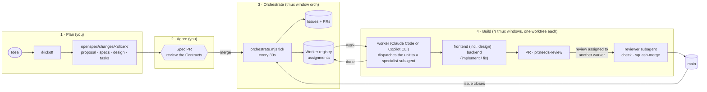
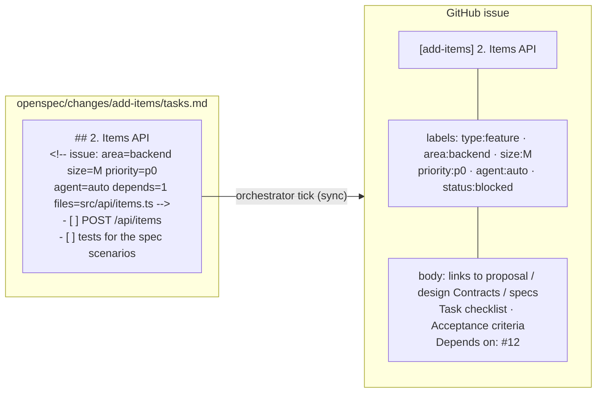
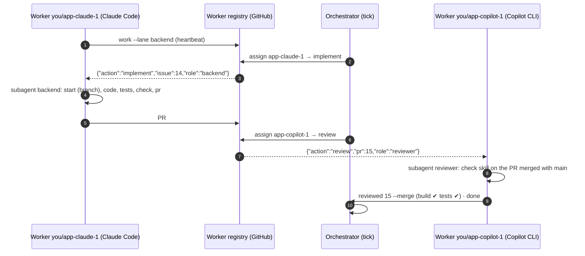
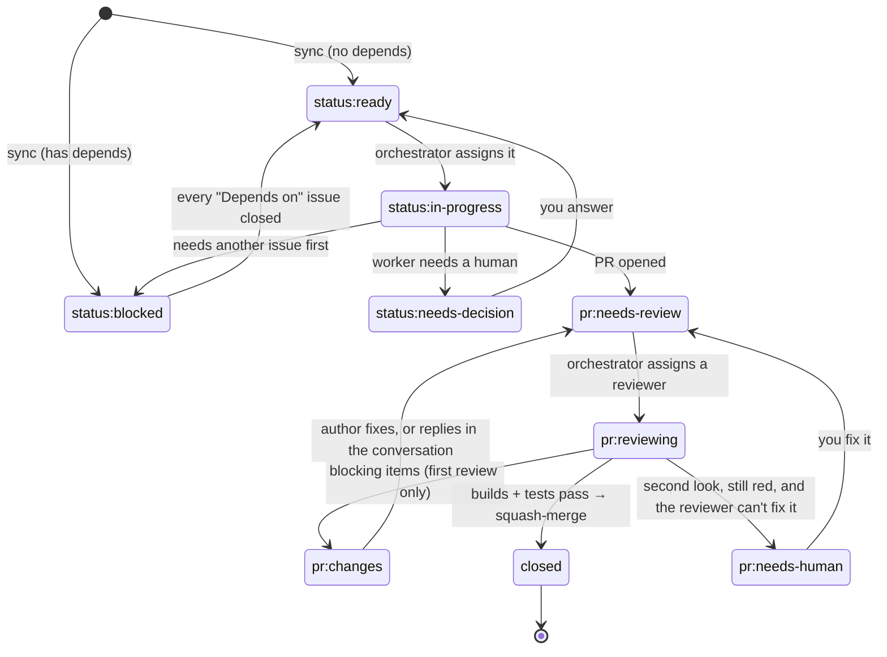

# Specflow 🚀

> **New in this version:** Claude Code and Copilot CLI on one machine, in tmux ([plans/claude-code-tmux.md](plans/claude-code-tmux.md)). It hasn't had a full end-to-end run yet (step 8 of the plan). The last VS Code / Windows / many-machines release is [`v0.1.0`](https://github.com/KKogaa/specflow/tree/v0.1.0).

A GitHub template repo that turns **Claude Code** and **GitHub Copilot CLI** into a parallel, spec-driven software factory on **one machine**. One **orchestrator agent** hands out the work. **Any number of worker agents** do it, each in its own git worktree and its own **tmux** window. Mix the two CLIs freely: any agent, orchestrator included, can be either one.

You write the plan once as **[OpenSpec](https://github.com/Fission-AI/OpenSpec) changes**, and every task group becomes a GitHub issue. The orchestrator assigns issues and reviews to idle workers. The workers build, open PRs, and review and merge **each other's** PRs. You make the decisions: you agree the contracts and answer the questions workers park for you.

No cloud agents, no GitHub Actions, no server. The shared state is GitHub itself: issues, PRs, labels, and one **Worker registry** issue. `scripts/orchestrate.mjs` reads and writes that state, starts the tmux session, and keeps a **GitHub Project board** in step, so you can watch the work move from Ready to Done.

```
node scripts/orchestrate.mjs team up --claude 2 --copilot 2
```

```
tmux session specflow-<repo>
├─ orch       orchestrator agent (Claude Code by default), in the main checkout
├─ board      orchestrate.mjs status, refreshed every 30s
├─ claude-1   worker, lane frontend, in ../<repo>-claude-1
├─ claude-2   worker, lane backend,  in ../<repo>-claude-2
├─ copilot-1  worker, lane frontend, in ../<repo>-copilot-1
└─ copilot-2  worker, lane backend,  in ../<repo>-copilot-2
```

- [How it works](#how-it-works)
- [Roles](#roles)
- [Get started](#get-started): setup, playbook, changing the plan (in [docs/](docs/setup/README.md))
- [Reference](#reference)

---

## How it works



### Where the truth lives

| Thing | Location | Who writes it |
|-------|----------|---------------|
| Problem, demo script, scope, stack, lanes | `openspec/config.yaml` → `context:` | `kickoff` skill |
| Rules every agent follows when writing specs and tasks | `openspec/config.yaml` → `rules:` | the kit (don't edit mid-project) |
| One vertical slice: why, requirements, **API contracts**, tasks | `openspec/changes/<id>/` | `kickoff` / `plan-feature` |
| The current, merged behavior of the system | `openspec/specs/<capability>/spec.md` | `openspec archive` |
| The backlog and its state | GitHub issue and PR labels | the orchestrator (`tick`), plus workers for their own PRs |
| Which workers exist, which CLI and account each runs, and what each is doing | **Worker registry** issue: one heartbeat comment per worker, one assignments comment | each worker writes **only** its own comment, and the orchestrator writes **only** the assignments |
| The board you watch: every issue, in a **Stage** column | a **GitHub Project** linked to the repo | the orchestrator (`tick`), from the labels and PRs. It's a view: dragging a card changes nothing |

**Every piece of state has exactly one writer**, so nothing can race, however many workers you add.

### From a task group to an issue

Each `## N.` group in a change's `tasks.md` becomes exactly one issue and one PR. The metadata comment under the heading routes it.



An optional `assignee=<login>` in that comment reserves the group for a person, as you do for `scaffold`.

### Lanes and specialists

| Lane (`area:` label) | Specialist | Does |
|---|---|---|
| `area:frontend` | `frontend` | **Design and UI in one: an avid designer as well as a frontend engineer.** It builds the design system first (tokens, components, page shell, copy, guided by the `frontend-design` skill), then screens with every state, wired to the API against the Contracts |
| `area:backend` | `backend` | API, data, LLM and external-service calls, deploy, chores. Also takes bugs and chores with no area, and archive issues |
| any PR waiting for review | `reviewer` | Runs the checks on the PR merged with `main`, applies the lane's standards, then merges or sends it back |

A worker's lane is only a **preference**. The orchestrator fills each worker's own lane first, then lets idle workers help any lane, and the worker puts on whichever specialist the unit needs. Each unit runs in a fresh subagent, so a worker can loop all day without its context filling up. Both CLIs run the same agents and skills.

### How the orchestrator assigns work

Every 30 seconds, `tick` does the housekeeping: it creates issues for new task groups, unblocks dependents, and opens archive issues. Then it gives every **live, idle** worker the first of these that applies:

| # | Action | When | Why this order |
|---|--------|------|----------------|
| 1 | `fix` | A PR **this worker** opened was sent back (`pr:changes`) or has a merge conflict. Also anyone's, once its author's worker is gone | Finishing beats starting |
| 2 | `review` | A PR is waiting (`pr:needs-review`) that **another worker** opened, oldest first. A worker on a different GitHub account is preferred | PRs never pile up, and nobody reviews their own work |
| 3 | `implement` | A `status:ready` issue in the worker's lane, by priority. In a second pass, any lane | Lanes first, but nobody idles |

- **Live** means the worker polled in the last 5 minutes. A worker polls every 30 seconds while it waits.
- If a worker restarts (a closed tmux window, a `team down` and `team up`), its unfinished assignment comes back to it.
- A busy worker shows it's alive with `beat` at each checkpoint (`start`, `check` and `pr` do it for it) and with the commits it pushes. With no sign of life for **25 minutes** the orchestrator flags it to you, and at **45 minutes** it hands the unit to another worker, which continues the branch.
- A unit reported **failed** (`done --failed`), a review that ended without a verdict, and an issue whose PR was closed unmerged all go back to the pool, never to the same worker. After **two failures** the item goes to you (`status:needs-decision` or `pr:needs-human`).
- Nothing stays half-assigned: a new assignment is saved before its labels are written, so a crash in between is finished by the next tick. A failed round (a network blip) doesn't stop `tick --watch`.
- `tick` won't run alongside **another orchestrator** that was active in the last 2 minutes: `--watch` waits for it to go quiet. There is only ever one writer of assignments.

### One unit of work, end to end



### One account or two

GitHub doesn't let an account approve its own PR, and on one machine every agent normally runs as you. Specflow works either way:

| | One GitHub account (default) | Two accounts (optional) |
|---|---|---|
| Who reviews | any **other worker** | another worker, on the **other account** when one is live |
| The review | a comment review with the verdict and checklist | a real approval, or request changes |
| What gates the merge | a green `check` on the PR merged with `main` | the same, plus the approval |
| Branch protection on `main` | PR required, 0 approvals, no force push | PR required, 1 approval, no force push |
| Setup | nothing extra | sign the second account in to its own `gh` config dir, and point a CLI at it in `.env` (`SPECFLOW_GH_CONFIG_COPILOT=~/.config/gh-reviewer`). The launcher sets `GH_CONFIG_DIR` per window |

A natural split with two accounts: Claude Code workers run as you, Copilot CLI workers as the second account, so every PR gets reviewed across both CLIs and both accounts.

### Issue and PR lifecycle



**Review policy:** builds and unit tests pass, on the PR merged with `main`, or it doesn't merge. A PR is **sent back at most once**, with a checklist listing everything. On the second look, open points are settled in the PR conversation (the reviewer agrees, or opens a follow-up issue), and the reviewer makes a red build or failing tests green itself. A PR the reviewer can't make green goes to `pr:needs-human`. Details: the `review-pr` skill.

---

## Roles

| Role | How many | What they do |
|------|----------|--------------|
| **You** (the conductor) | 1 | Run `/kickoff` and drive `scaffold` interactively. Start the team with `team up`, answer the decisions the orchestrator surfaces, and run `/plan` when scope changes. Watch the tmux windows, approve anything an agent asks permission for, and restart a window when its context gets long. |
| **Orchestrator** (an agent) | exactly 1 | Claude Code or Copilot CLI in the `orch` window, in the main checkout, running the `orchestrator` agent. It assigns every unit of work, keeps the board moving, and flags what needs you. It never writes code. |
| **Workers** (agents) | any number | Each one is a long-running Claude Code or Copilot CLI session in its own worktree and tmux window, with a preferred lane (`frontend` or `backend`). A worker doesn't write code itself: it hands each unit to a **specialist**. Start with two to four, and `team add` more when the backlog and the machine can take it. |
| **Specialists** (agents) | one per unit | `frontend` (which is also the designer), `backend` and `reviewer`. The worker starts one as a **subagent** with a fresh context for each unit, picked by the unit's `role` (from the issue's `area:` label, or `reviewer` for reviews). Their know-how lives in the `role-frontend` (with `frontend-design`) and `role-backend` skills. |

`agent:auto` marks issues that are specified well enough to finish with **no human decisions**. A worker started with `--auto-only` takes only those, which is useful when you're away from the machine.

---

## Get started

Everything about **setting up and running** the kit lives in `docs/`, not in this README:

| You want to… | Read |
|---|---|
| Add the kit to your own project, with no cloning of this repo: `npx -y github:KKogaa/specflow` | [docs/setup/repo.md](docs/setup/repo.md) |
| Set up the machine: tmux, Node, `gh`, OpenSpec, Claude Code, Copilot CLI, and an optional second account | **[docs/setup/machine.md](docs/setup/machine.md)** |
| Kick off, scaffold, start the team, and keep it running | [docs/setup/running.md](docs/setup/running.md) |
| Know what to do during the day: kickoff, build loop, final stretch | [docs/playbook.md](docs/playbook.md) |
| Add a feature, file a bug, reprioritize or cancel mid-project | [docs/changing-the-plan.md](docs/changing-the-plan.md) |

---

## Reference

### The skills

Both CLIs read skill descriptions and load the right one automatically, and the worker agent calls them by name. They live once in `.claude/skills/`, which Claude Code and Copilot CLI both load.

| Skill | Phase | Used by |
|-------|-------|---------|
| `kickoff` | Plan | `/kickoff` |
| `plan-feature` | Plan | `/plan` |
| `implement-issue` | Build | specialists: `implement` |
| `role-frontend` (design included), `role-backend` | Build | the matching specialist, and `reviewer` for lane standards |
| `fix-pr` | Build | specialists: `fix` |
| `check` | Test (the CI) | `implement-issue`, `open-pr`, `review-pr` |
| `write-tests` | Test | `implement-issue` |
| `open-pr` | Ship | `implement-issue` |
| `review-pr` | Review | `reviewer` |
| `standup` | Track | `/standup` |
| `ship-release` | Release | "Cut the demo release" |
| `demo-prep` | Demo | `/demo` |
| `frontend-design` | Design | `role-frontend`. Anthropic's skill, **not shipped**: install it during [setup](docs/setup/machine.md) |
| `openspec-*` | Spec | the skills above, and `/opsx-*` |

### Slash commands

| Command | Who | What it does |
|---------|-----|--------------|
| `/work <lane>` | a worker window | The worker loop (`team up` starts it for you) |
| `/orchestrate` | the `orch` window | The orchestrator loop |
| `/kickoff <idea>` | you | Idea → OpenSpec brief and changes → spec PR |
| `/plan <feature>` | you | New feature → OpenSpec change → spec PR. Or just ask the orchestrator |
| `/decide` | you | Walk through the questions workers parked |
| `/standup` | you | Status summary |
| `/demo` | you | Demo prep |
| `/opsx-*` | anyone | OpenSpec's own commands (propose, apply, archive, explore…) |

They live in `.claude/commands/`, which both CLIs read. Each one says which agent to act as, so it works from any session. Without them, pick the agent with `/agent <name>` (or `--agent <name>`) and ask in plain words, for example *"use the kickoff skill: we're building …"*. `team up` starts the orchestrator and the workers this way.

### Labels

| Group | Labels | Set by |
|-------|--------|--------|
| status | `status:ready` `status:in-progress` `status:blocked` `status:needs-decision` | orchestrator, workers, `/decide` |
| pr | `pr:needs-review` `pr:reviewing` `pr:changes` (sent back, once) `pr:needs-human` (the reviewer couldn't make it green) | `open-pr`, orchestrator, `review-pr` |
| area (lane) | `area:frontend` (design included) `area:backend` | `tasks.md` metadata |
| size | `size:S` (<1h) `size:M` (1–2h) `size:L` (split it) | `tasks.md` metadata |
| priority | `priority:p0` (demo path) `priority:p1` `priority:p2` | `tasks.md` metadata |
| type | `type:feature` `type:bug` `type:chore` `type:docs` `type:feature-request` | `tasks.md` metadata, issue templates (feature requests wait for you) |
| agent | `agent:auto`: an unattended worker can finish it | `tasks.md` metadata |

### The orchestrator script

```
# the team (tmux)
node scripts/orchestrate.mjs team up --claude 2 --copilot 2   # worktrees + tmux session: orch, board, 4 workers (safe to repeat)
node scripts/orchestrate.mjs team up --orchestrator copilot   # same, with Copilot CLI as the orchestrator (default: claude)
node scripts/orchestrate.mjs team add copilot --lane frontend # one more worker window
node scripts/orchestrate.mjs team status                      # the session's windows: name, running command, folder
node scripts/orchestrate.mjs team down                        # stop the session; worktrees, branches and stashes stay
tmux attach -t specflow-<repo>                                # get back in after closing the terminal

# anyone
node scripts/orchestrate.mjs status                           # board, workers and assignments (read-only)
node scripts/orchestrate.mjs sync --dry-run                   # preview the issues a spec would create

# orchestrator (exactly one)
node scripts/orchestrate.mjs setup                            # labels, worker registry issue, project board (once, safe to repeat)
node scripts/orchestrate.mjs tick --watch 10                  # assign work every 30s for 10 min, then report
node scripts/orchestrate.mjs take scaffold                    # assign a change's open issues to me

# worker (any number)
node scripts/orchestrate.mjs work --lane frontend --wait 10   # heartbeat + my unit and its role as JSON (waits up to 10 min)
node scripts/orchestrate.mjs done [--failed]                  # I finished my unit (or gave up on it)
node scripts/orchestrate.mjs beat coding                      # still alive, mid-unit (specialists, every ~15 min)
node scripts/orchestrate.mjs start 12                         # branch 12-<slug> from main, or continue the issue's branch
node scripts/orchestrate.mjs rebase                           # bring this branch up to date with main
node scripts/orchestrate.mjs check                            # the CI: the Commands table, recorded for this commit
node scripts/orchestrate.mjs pr --title "feat(api): items" --body-file .orchestrate/pr-body.md  # push + open the PR
node scripts/orchestrate.mjs park 12 --body-file .orchestrate/question.md  # ask a human, step away
node scripts/orchestrate.mjs review-start 15                  # the PR merged with main, ready for check
node scripts/orchestrate.mjs reviewed 15 --merge --body-file .orchestrate/review-15.md  # approve or comment, then merge what check passed (or --changes: once per PR)
node scripts/orchestrate.mjs worktree w5                      # a worktree by hand (team up makes them for you)
```

### Checks (the CI)

The `check` skill runs `openspec validate --all --strict`, then the Install, Lint, Test and Build commands from the **Commands** table in `AGENTS.md`. `scaffold` fills those in. The author runs it before opening a PR, and the reviewer runs it again on the PR merged with `main` before merging. Both run the same commands because both read them from the same table.

### What's in the repo

| Path | Purpose |
|------|---------|
| `docs/setup/` | Setup: the machine, the repo, and running the team |
| `docs/playbook.md`, `docs/changing-the-plan.md` | Running the day, and changing scope mid-project |
| `openspec/config.yaml` | Project brief, plus the rules that make agents write issue-ready tasks |
| `openspec/changes/`, `openspec/specs/` | Planned changes, and the merged spec of the system |
| `AGENTS.md`, `CLAUDE.md` | Always-on rules and the team workflow. `CLAUDE.md` imports `AGENTS.md` for Claude Code; Copilot CLI reads `AGENTS.md` itself |
| `.claude/agents/` | The agents, read by both CLIs: `orchestrator` (exactly one), `worker` (any number), the specialists `frontend` (design included), `backend` and `reviewer`, and `conductor` |
| `.claude/skills/*/SKILL.md` | Agent Skills: the SDLC workflows, read by both CLIs |
| `.claude/commands/` | Slash commands, read by both CLIs: `/work`, `/orchestrate`, `/kickoff`, `/plan`, `/decide`, `/standup`, `/demo`, `/opsx-*` |
| `.claude/settings.json` | Permissions: routine commands allowed so workers run unattended, merges and force pushes denied. Claude Code reads it; `team up` passes the same rules to Copilot CLI as `--allow-tool` / `--deny-tool` |
| `.github/copilot-instructions.md` | Copilot's always-on rules (they point to `AGENTS.md`) |
| `.github/instructions/` | Coding standards: `coding-standards` (every file), `typescript`, `react`, and for the backend `backend-architecture` (pragmatic hexagonal) with `fastify` or `java` + `quarkus`. Kickoff keeps the chosen backend's |
| `scripts/orchestrate.mjs` | The coordinator (Node, no dependencies): labels, worker registry, sync, assignment, recovery, unblock, archive, worktrees, the tmux launcher, and the scripted unit steps: branches, the CI (`check`), PRs and the merge gate. Fork-aware |
| `.github/ISSUE_TEMPLATE/`, `.github/pull_request_template.md` | Bug/task templates and the PR checklist |
| `bin/create.mjs`, `package.json`, `plans/` | The `npx` installer and the kit's own plans. Not copied by it, and neither is this README (kickoff writes the project's own) |
| `.editorconfig`, `.gitattributes` | LF everywhere |

### Compatibility

One machine running **Linux, macOS or WSL**, with tmux.

| | |
|---|---|
| **Claude Code** 2.1+ (`claude --agent <name>`, subagents through the Agent tool) | ✅ orchestrator or worker |
| **GitHub Copilot CLI** 1.0.100+ (`copilot --agent <name>`, subagents through the `task` tool; reads `.claude/` agents, skills and commands) | ✅ orchestrator or worker |
| VS Code, Windows, several machines | use [`v0.1.0`](https://github.com/KKogaa/specflow/tree/v0.1.0) |

Rules for changing the kit:
- **The coordinator stays one Node script with no dependencies.** Agent workflows are skills. Small helper shell is fine; build paths with `node:path` in Node.
- An agent feature must work in **both** Claude Code and Copilot CLI. If something exists in only one, document the fallback for the other.
- **One source per asset.** Agents, skills and commands live once in `.claude/`; both CLIs read them. Keep agent frontmatter to `name` and `description`, which both understand.
- Free text for `gh` and `git` (PR bodies, reviews, comments, commit messages) goes in a file under `.orchestrate/`, never inline, so quoting never mangles it. Always quote `"@me"`.
- Files stay **LF** (`.gitattributes`).

## Rules that keep it fast

1. **Contracts first.** Frontend and backend build against the `## Contracts` in each change's `design.md`, not against each other.
2. **One task group = one issue = one PR**, under 400 lines, squash-merged.
3. **Only the orchestrator assigns work.** Single-writer assignment is what lets you add workers without collisions.
4. **Finish before starting**: fix your PRs, then review, then build.
5. **Never break main.** The checks failing on main is p0 for everyone.
