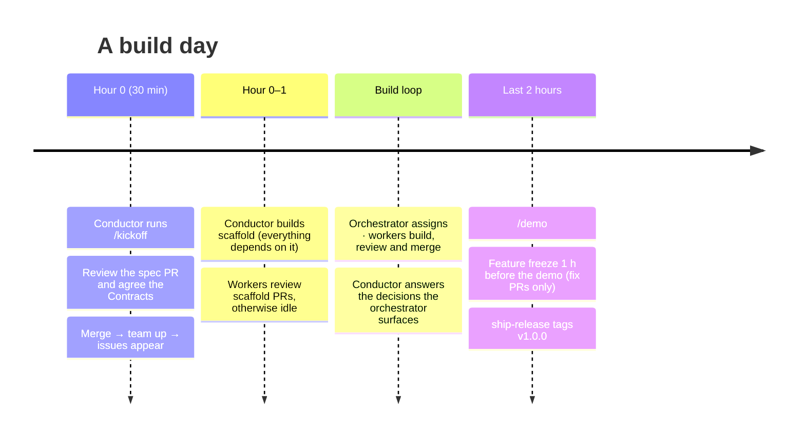

# Playbook

What you do, hour by hour, once the machine is set up ([setup/](setup/README.md)).

## Hour 0: Kickoff (about 30 minutes)

1. The conductor runs, in Claude Code or Copilot CLI in the repo folder:
   > `/kickoff a shared grocery list for roommates`

   The agent asks for anything it's missing in one message. Then it proposes the **must-haves** (what the demo needs end to end) and a numbered list of **opportunities** it found (a wow moment, a twist, polish), each with its cost, risk and a recommendation. Reply with the numbers to include. Then it:
   - fills the project brief in `openspec/config.yaml`
   - creates a `scaffold` change, reserved for the conductor with `assignee=`, plus 4–8 vertical-slice changes for the must-haves and one per approved opportunity (p1/p2, so they can be cut without breaking the demo), each with a **Contracts** section in `design.md`
   - runs `openspec validate --all --strict` and previews the backlog with `node scripts/orchestrate.mjs sync --dry-run`
   - opens the spec PR `docs(spec): MVP spec and contracts`
2. **Review the spec PR**, mostly the `## Contracts` sections. This is the most important review of the day, because every worker will build against these shapes in parallel.
3. Merge it, then [start the team](setup/running.md#2-start-the-team): `node scripts/orchestrate.mjs team up --claude 2 --copilot 2`. Its first tick creates the issues, with their dependencies linked. The `scaffold` issues come out already assigned to the conductor.
4. The conductor builds `scaffold` interactively, in a worktree of their own ([running.md, step 3](setup/running.md#3-build-scaffold)): repo skeleton, the Install/Lint/Test/Build rows of the **Commands** table in `AGENTS.md` (which the `check` skill runs), hello world deployed. Every other issue depends on `scaffold`, so workers review scaffold PRs and otherwise wait until it merges. Then the whole board unblocks at once.

## During the build

- **Every ~45 minutes, glance at the worker windows** (`Ctrl-b w`). If one's context has grown long, `/clear` and `/work <lane>`, or exit and re-run its start command (↑ Enter). A fresh context keeps it fast and focused, and its unfinished assignment comes back to it.
- **Conductor:** keep an eye on the orchestrator's terminal. It surfaces decisions workers parked (`status:needs-decision`), stuck workers, and an empty or fully blocked backlog, and it posts a short status every ~30 minutes. Answer decisions right there, or with `/decide`.
- **New idea, bug or change of priority?** Tell the orchestrator. See [changing-the-plan.md](changing-the-plan.md).
- **Lanes running dry?** The orchestrator already moves idle workers into other lanes. If one lane has far more work, add a worker for it: `node scripts/orchestrate.mjs team add claude --lane <lane>`.

## Final 2 hours

- `/demo` produces the README, `docs/DEMO.md`, a seed script, and a list of demo-path risks.
- Feature freeze 1 hour before the demo: only `fix:` PRs on the demo path get merged. Once the board is empty, `team down` stops every window.
- *"Cut the demo release"* (the `ship-release` skill) tags v1.0.0, deploys, and smoke-tests.
